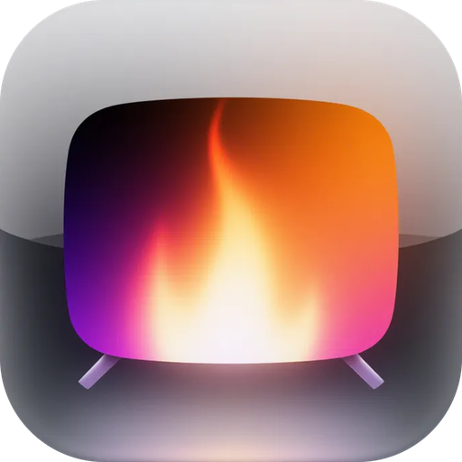
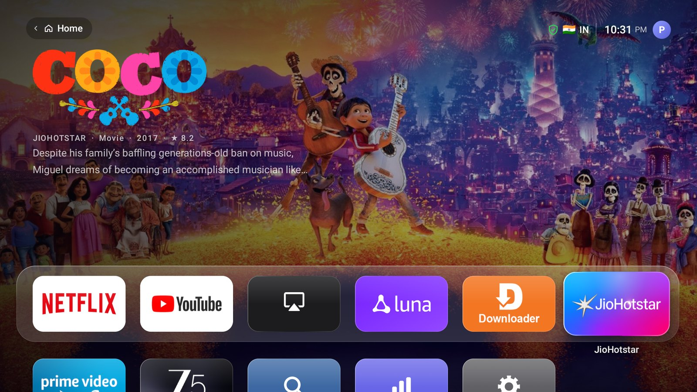
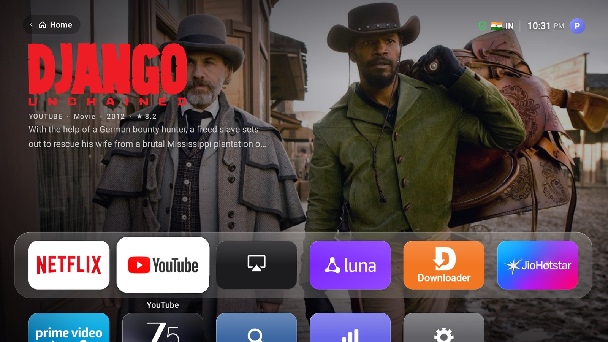
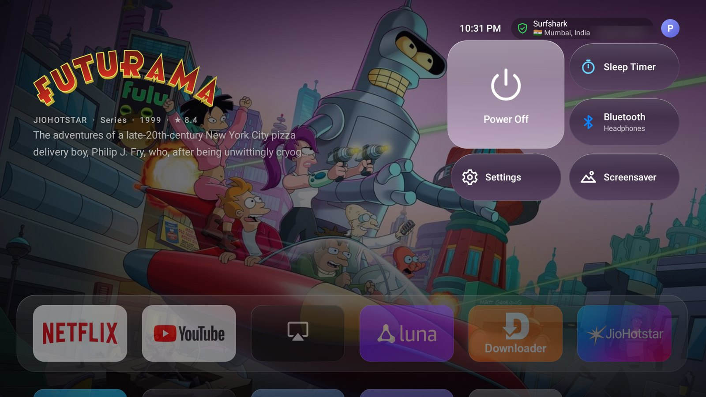
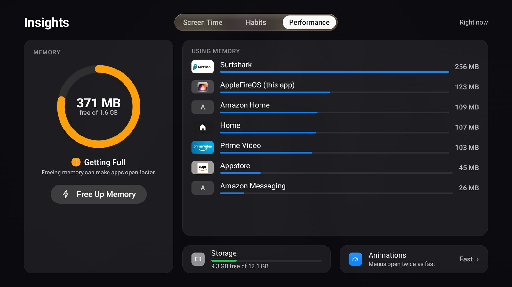
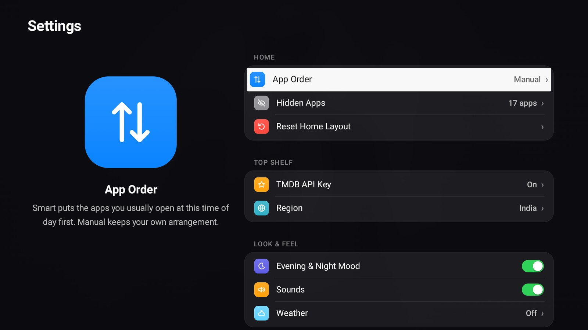
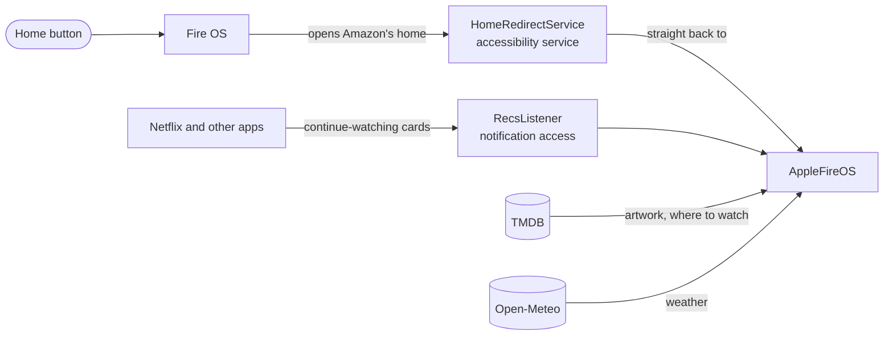

<div align="center">



# AppleFireOS

**A tvOS-style home screen for Amazon Fire TV.**<br>
A Top Shelf, Control Center, glass panels and spring animations, with no ads, no sponsored rows
and no autoplaying trailers.

[](https://github.com/pri-te-sh/AppleFireOS/releases/latest)
[](https://github.com/pri-te-sh/AppleFireOS/releases)
[](LICENSE)
[](#-install-in-3-minutes)
[](https://github.com/pri-te-sh/AppleFireOS/stargazers)


<a href="https://github.com/pri-te-sh/AppleFireOS/releases/latest/download/AppleFireOS.apk">
  
</a>
<a href="https://pri-te-sh.github.io/AppleFireOS/">
  
</a>

<br><br>



</div>

---

## ✨ Features

<table>
<tr>
<td width="33%" valign="top">

### 🎬 Top Shelf
Move onto an app and the whole screen fills with its artwork: what you were watching on
Netflix, or what's popular on Prime Video, Disney+ and others, with **Play** to jump straight in.
Slow Ken Burns crossfades, like tvOS.

</td>
<td width="33%" valign="top">

### 🎛️ Control Center
Press Up from the shelf: power, sleep timer, Bluetooth, the screensaver, what's playing, and
your VPN with the country you appear from.

</td>
<td width="33%" valign="top">

### 🧭 Sidebar & Profiles
The tvOS 26 sidebar for Home, Find, Insights and Settings, and a profile switcher that grows
from your avatar.

</td>
</tr>
<tr>
<td valign="top">

### 📊 TV Insights
Screen time by app and hour, your viewing habits over the week, live memory use, and one press
to close what's slowing the TV down.

</td>
<td valign="top">

### 🗂️ Your layout
Rearrange apps, group them into folders, hide the ones you never use, or let **Smart order**
put what you usually watch at this time of day first.

</td>
<td valign="top">

### 🛡️ VPN status
A shield beside the clock with the flag of the country your VPN connects through, and an alert
if it drops, even while you're watching something.

</td>
</tr>
<tr>
<td valign="top">

### 🌤️ Weather & mood
Current weather next to the time (Open-Meteo, no account). Colours warm up in the evening and
dim late at night.

</td>
<td valign="top">

### 🌍 Aerial screensaver
Apple's aerial flyovers over cities, coasts and the Earth from space, full screen.

</td>
<td valign="top">

### 🪶 Light and fast
Every screen is native Android views: no WebView, no frameworks. It uses about **150 MB** of
memory and runs at **60 fps** on a Fire TV Stick 4K Max.

</td>
</tr>
</table>

## 📸 Screenshots

<table>
<tr>
<td></td>
<td></td>
</tr>
<tr>
<td align="center"><b>Home</b>: the Top Shelf and your apps</td>
<td align="center"><b>Control Center</b>: power, sleep timer, Bluetooth, VPN</td>
</tr>
<tr>
<td></td>
<td></td>
</tr>
<tr>
<td align="center"><b>TV Insights</b>: what's using memory, one press to free it</td>
<td align="center"><b>Settings</b></td>
</tr>
</table>

<sub>Screenshots from a Fire TV Stick 4K Max. Artwork and titles come from TMDB.</sub>

## 🚀 Install in 3 minutes

Fire OS doesn't let you change the home screen from the TV itself, so a computer switches it on,
once. You need the TV and a computer on the same network.

**1. On the TV:** open **Settings › My Fire TV › Developer Options** and turn on **ADB Debugging**.
(No Developer Options? Go to **Settings › My Fire TV › About** and press Select on the device
name seven times.) Note the TV's IP address from **Settings › My Fire TV › About › Network**.

**2. On the computer:** install `adb` if you don't have it:

```bash
brew install android-platform-tools        # macOS
sudo apt install adb                       # Debian / Ubuntu
```

**3. Run setup** with your TV's IP address:

```bash
curl -fsSLO https://raw.githubusercontent.com/pri-te-sh/AppleFireOS/main/setup.sh
bash setup.sh 192.168.1.20
```

The TV asks whether to allow the computer: choose **Allow**. `setup.sh` downloads the latest
release, installs it, and switches on the Home button, the Top Shelf and Insights. Press **Home**
on the remote and you're in.

<details>
<summary><b>Optional: movie and show artwork for the Top Shelf (free TMDB key)</b></summary>

<br>

Netflix fills the Top Shelf by itself. For artwork from Prime Video, Disney+, Max, Hulu and
others, AppleFireOS uses [The Movie Database](https://www.themoviedb.org). Create a free account,
copy the API key from **Settings › API**, then either:

```bash
bash setup.sh 192.168.1.20 --tmdb YOUR_KEY
```

or type it on the TV in **Settings › Top Shelf › TMDB API Key**.

</details>

<details>
<summary><b>No computer? Install with the Downloader app</b></summary>

<br>

1. Install **Downloader** from the Amazon Appstore, and allow it to install apps
   (**Settings › My Fire TV › Developer Options › Install unknown apps**).
2. In Downloader, enter `https://github.com/pri-te-sh/AppleFireOS/releases/latest/download/AppleFireOS.apk`
   and install it.
3. Open **AppleFireOS** from your apps.

It works as an app this way, but the remote's Home button still opens Amazon's home screen until
the permissions are granted with adb. AppleFireOS shows what's missing on first launch
(and in **Settings › Set Up AppleFireOS**). Any adb app on a phone on the same network works
too: run the commands from [`setup.sh`](setup.sh).

</details>

## 🎮 Using it

| Remote | Does |
|---|---|
| **Home** | Comes back to AppleFireOS from anywhere |
| **Up** from the top row | Into the Top Shelf; Up again opens Control Center |
| **Left** from the first column | The sidebar: Home, Find, Insights, Settings |
| **Hold Select** on an app | Move it, put it in a folder, hide it or uninstall it |
| **Menu** (☰) | The same options for the focused app |
| **Select** in the Top Shelf | Plays or resumes the title shown |

## 🧠 How it works



- **The Home button.** Fire OS always starts Amazon's own home screen and ignores the "default
  launcher" setting. A small accessibility service sees it open and returns you to AppleFireOS in
  the same moment, so the Home button behaves as if AppleFireOS were the system home.
- **The Top Shelf** reads the cards apps already publish for Fire TV's own home screen (Netflix's
  "continue watching", for example) through notification access, and adds TMDB artwork for
  streaming services when you give it a key.
- **Insights** reads Android's usage stats and `dumpsys`, which is why it needs the `DUMP` and
  usage permissions that only adb can grant.
- **One design language.** Every colour, size, corner, gap and animation curve comes from
  `Theme.java` and `Motion.java`; screens are built from `Kit`, `Row`, `PageScaffold` and
  `PanelScaffold`. `tools/design-lint.sh` runs on every build and fails it if a screen styles
  itself.

## ❓ FAQ

<details>
<summary><b>How do I go back to the Amazon home screen?</b></summary>

<br>

```bash
bash setup.sh 192.168.1.20 --uninstall
```

That turns off the Home button redirect and uninstalls AppleFireOS. Or uninstall it on the TV in
**Settings › Applications › Manage Installed Applications**: the Home button goes back to Amazon's
home straight away.

</details>

<details>
<summary><b>Which devices does it work on?</b></summary>

<br>

It's developed and tested on a **Fire TV Stick 4K Max** (Fire OS 8). It needs Android 7.1 or
later, so Fire OS 6 and newer, and is laid out for 1080p and 4K TVs. If you try it on another Fire TV, please
[open an issue](https://github.com/pri-te-sh/AppleFireOS/issues) to say how it went.

</details>

<details>
<summary><b>What do the permissions do?</b></summary>

<br>

| Permission | Why |
|---|---|
| Accessibility service | Sends the Home button to AppleFireOS. It only watches for Amazon's home screen opening; it reads nothing else. |
| Notification access | Top Shelf cards from your apps, and your VPN app's status. |
| Usage access | Screen Time and Smart order. |
| `DUMP` | Memory use and which app owns the VPN, for Insights and Control Center. |
| `WRITE_SECURE_SETTINGS` | Insights' "faster animations" switch. |

</details>

<details>
<summary><b>Is anything sent anywhere?</b></summary>

<br>

No analytics, no accounts and no tracking. AppleFireOS only contacts TMDB (if you add a key) for
artwork, Open-Meteo (if you set a city) for the weather, a public IP-to-country lookup for the
VPN flag, and Apple's servers for the aerial videos. Your layout, screen time and settings stay
on the TV.

</details>

<details>
<summary><b>Can I make the TV lighter too?</b></summary>

<br>

`tools/debloat.sh` turns off Amazon background services most people never use (telemetry,
metrics, Shop, miniTV, Photos, Kids and some Alexa extras) to free memory. Updates, the
Appstore, Alexa voice and the keyboard are left alone, nothing is uninstalled, and `restore`
turns everything back on.

```bash
tools/debloat.sh 192.168.1.20 status     # see what's on
tools/debloat.sh 192.168.1.20 disable    # turn them off
tools/debloat.sh 192.168.1.20 restore    # undo
```

</details>

<details>
<summary><b>Will a Fire OS update break it?</b></summary>

<br>

Updates sometimes turn accessibility services off. If the Home button opens Amazon's home again,
run `setup.sh` once more; your layout and settings are kept.

</details>

## 🛠️ Build from source

No Gradle and no dependencies: `build.sh` runs the Android SDK's own tools (aapt2, javac, d8,
apksigner) and builds in a few seconds.

You need a JDK 8+ and the Android SDK with build-tools and the Android 13 (API 33) platform.

```bash
git clone https://github.com/pri-te-sh/AppleFireOS.git
cd AppleFireOS
./build.sh                                  # → build/AppleFireOS.apk
FIRETV=192.168.1.20 ./build.sh --install    # build, install and set up on your TV
```

Set `ANDROID_HOME` if the SDK isn't found. Put a TMDB key in `tmdb.key` to build it into the APK
(it's git-ignored). The first build makes a signing key, `keystore.jks`; keep it to install
updates over your build.

```
src/com/applefireos/home/
├── NativeHome.java       the home screen: shelf, app grid, folders, keys
├── Theme.java            design tokens: colours, type scale, radii, spacing, focus lift
├── Motion.java           every animation curve and transition
├── Kit.java, Row.java    the components every screen is built from
├── PageScaffold.java     full-screen pages (Settings, Insights, Find, Setup)
├── PanelScaffold.java    glass panels (sheets, sidebar, profiles, folders, keyboard)
├── HomeRedirectService   the Home button
└── RecsListener          Top Shelf cards and VPN status from notifications
```

## 🤝 Contributing

Issues and pull requests are welcome. A few house rules keep it feeling like one product:

- **Use the design system.** Take colours and sizes from `Theme`, components from `Kit` and
  `Row`, and animations from `Motion`. If something's missing, add it there rather than styling
  a screen by hand. `./build.sh` runs `tools/design-lint.sh` and stops on violations.
- **Keep it light.** No new dependencies, no WebViews, and no work on the main thread that could
  drop a frame. Check pacing with `adb shell dumpsys gfxinfo com.applefireos.home framestats`.
- **Test on a real Fire TV** and say which model in the pull request.

## 📄 License

[MIT](LICENSE) © 2026 Pritesh Bhavsar

<sub>Apple, Apple TV and tvOS are trademarks of Apple Inc. Amazon, Fire TV and Fire OS are
trademarks of Amazon.com, Inc. Netflix and the other services named are trademarks of their
owners. AppleFireOS is an independent project, inspired by tvOS, and isn't affiliated with or
endorsed by Apple or Amazon. Artwork and metadata come from TMDB; this product uses the TMDB API
but is not endorsed or certified by TMDB.</sub>

<div align="center">

**If AppleFireOS made your Fire TV feel new, give it a ⭐!**

</div>
